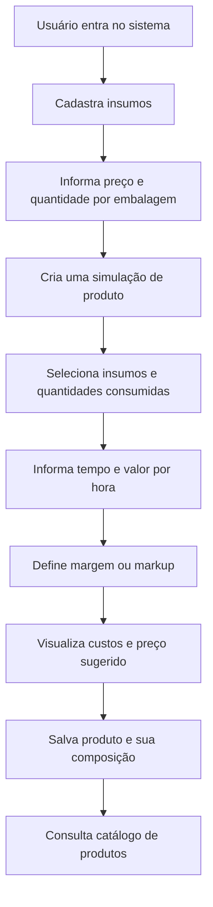
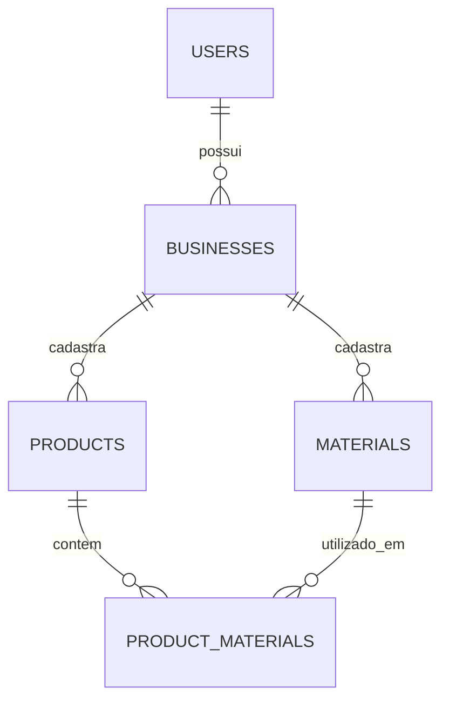

# Phobos — Gestão de Produtos e Precificação

> Sistema web para organizar insumos, calcular custos de produção e definir preços de venda de produtos artesanais e de pequenos negócios.

## Sobre o projeto

O **Phobos — Gestão de Produtos e Precificação** é uma aplicação web que centraliza o cadastro de materiais utilizados na produção, o tempo de trabalho e a formação de preços. Seu objetivo é substituir cálculos manuais e informações dispersas em planilhas por um fluxo simples e confiável:

**Cadastrar insumos → calcular o custo → definir o preço → salvar e consultar o produto.**

Um caso de uso é a precificação de amigurumis: a pessoa cadastra fios, enchimento, olhos e embalagem, informa quanto utilizou de cada material e o tempo de confecção, e o sistema calcula o custo total e sugere um preço de venda com base na margem ou no markup desejado.

### Objetivos

- Centralizar materiais, custos, composições e preços de produtos.
- Considerar o consumo de insumos e o valor da mão de obra.
- Reduzir erros e esquecimentos durante a precificação.
- Permitir consultar e atualizar produtos sem perder a referência do custo anteriormente calculado.
- Criar uma base que possa evoluir para estoque, vendas e relatórios.

## Escopo

### MVP — primeira versão

- **Autenticação:** cadastro, login e acesso aos dados do próprio negócio.
- **Negócio:** identificação e configurações de moeda e valor/hora padrão.
- **Insumos/consumíveis:** cadastro, edição, desativação e consulta de materiais, incluindo unidade, quantidade por embalagem, preço de compra, marca e variação/cor.
- **Calculadora de custos:** seleção dos insumos, quantidades consumidas, tempo de produção e custo/hora.
- **Precificação:** simulação com margem sobre o preço de venda ou markup sobre o custo, identificados separadamente.
- **Produtos:** nome, descrição, imagem, composição, custos calculados e preço de venda.
- **Catálogo:** listagem, busca, visualização e edição dos produtos.

### Evoluções planejadas (fora do MVP)

- Estoque e movimentações de entrada/saída.
- Histórico de preços de compra dos materiais.
- Categorias de produtos.
- Dashboard com indicadores e relatórios.
- Duplicação de produtos e comparação de cenários de precificação.
- Clientes, vendas e itens vendidos.
- Eventual colaboração de vários usuários por negócio, se houver demanda.

> **Nota de escopo:** controle de estoque e vendas aparecem como possibilidades na planilha de referência, mas não são pré-requisitos para concluir o fluxo principal descrito no documento de visão geral.

## Stack proposta

| Camada              | Tecnologia                                     | Papel                           |
| ------------------- | ---------------------------------------------- | ------------------------------- |
| Aplicação web       | Next.js + TypeScript                           | Interface e lógica de servidor  |
| Interface           | Tailwind CSS + componentes reutilizáveis       | Layout responsivo               |
| Banco de dados      | PostgreSQL                                     | Persistência dos dados          |
| ORM                 | Drizzle ORM                                    | Schema, consultas e migrações   |
| Validação           | Zod                                            | Validação das entradas          |
| Autenticação        | A definir (por exemplo, Better Auth)           | Login e sessões                 |
| Cálculos monetários | Biblioteca decimal, como `decimal.js`          | Evitar erros de ponto flutuante |
| Imagens             | Armazenamento compatível com objeto, a definir | Fotos de insumos e produtos     |

A stack é uma **proposta de implementação**, não um requisito dos materiais originais.

## Fluxo principal



## Telas previstas

| Tela                       | Principais responsabilidades                                   |
| -------------------------- | -------------------------------------------------------------- |
| Login/cadastro             | Autenticação do usuário                                        |
| Insumos                    | Listar, buscar e cadastrar materiais e seus custos             |
| Calculadora                | Montar composição, informar trabalho e simular preço           |
| Novo/editar produto        | Salvar identificação, imagem, composição e resultado calculado |
| Produtos                   | Consultar catálogo, custos, preços e detalhes                  |
| Configurações              | Nome do negócio, moeda e valor/hora padrão                     |
| Dashboard (posterior)      | Indicadores consolidados                                       |
| Estoque/vendas (posterior) | Movimentações de materiais e registro de vendas                |

## Modelo de dados

### Tabelas do MVP

**`users`** — `id`, `name`, `email`, `created_at`. A ferramenta escolhida de autenticação poderá exigir tabelas adicionais de sessão, conta e verificação.

**`businesses`** — `id`, `owner_id`, `name`, `currency`, `default_hourly_rate`, `created_at`.

**`materials`** — `id`, `business_id`, `name`, `brand`, `variant`, `image_url`, `unit`, `purchase_price`, `package_quantity`, `active`, `created_at`, `updated_at`.

**`products`** — `id`, `business_id`, `name`, `description`, `image_url`, `production_minutes`, `hourly_rate`, `materials_cost`, `labor_cost`, `total_cost`, `margin_type`, `profit_percent`, `sale_price`, `active`, `created_at`, `updated_at`.

**`product_materials`** — `id`, `product_id`, `material_id`, `quantity`, `unit_cost`, `total_cost`.

### Relacionamentos



**Decisões de modelagem:**

- Um produto pode consumir vários insumos; um insumo pode ser utilizado em vários produtos.
- O custo do insumo utilizado em cada composição é registrado como um *snapshot* (`unit_cost` e `total_cost`) para preservar o cálculo salvo.
- O vínculo entre produto e insumo não deve depender de colunas fixas do tipo “fio”, “olhos” ou “embalagem”.
- As consultas e alterações devem filtrar pelo negócio autorizado (`business_id`); relações cruzadas entre negócios devem ser rejeitadas.
- Valores monetários e quantidades devem usar tipos decimais apropriados.
- Para o MVP, um usuário pode ter um negócio; a modelagem permite evoluir para vários negócios no futuro.

### Tabelas futuras

`customers`, `orders`, `order_items`, `inventory_movements`, `material_price_history`, `product_categories` e, caso haja colaboração entre usuários, `business_members`.

## Regras de negócio e precificação

### Custo de material

Para um insumo comprado em embalagem:

```text
custo_unitario = preco_da_embalagem / quantidade_da_embalagem
custo_consumido = custo_unitario * quantidade_consumida
custo_dos_insumos = soma(custo_consumido de cada insumo)
```

Exemplo: um novelo de 125 g comprado por R$ 19,50 custa R$ 0,156/g; consumir 20 g representa R$ 3,12.

**Unidades:** a quantidade consumida precisa estar na mesma unidade-base usada para o custo. Caso haja unidades distintas, a conversão deve ser explícita (por exemplo, kg → g).

### Mão de obra

```text
custo_mao_de_obra = (minutos_de_producao / 60) * valor_por_hora
custo_total = custo_dos_insumos + custo_mao_de_obra
```

### Preço de venda

O sistema poderá oferecer dois métodos, claramente identificados:

**Margem sobre a venda** (percentual do preço final):

```text
preco_venda = custo_total / (1 - margem_percentual / 100)
```

**Markup sobre o custo** (acréscimo ao custo):

```text
preco_venda = custo_total * (1 + markup_percentual / 100)
```

Exemplo para custo total de R$ 35,00 e percentual de 30%:

| Método        | Preço sugerido |
| ------------- | -------------: |
| Margem de 30% |       R$ 50,00 |
| Markup de 30% |       R$ 45,50 |

**Validações:** custo, tempo e taxas não podem ser negativos; margem sobre a venda deve ser menor que 100%; embalagem e quantidade de compra precisam ser maiores que zero. Os cálculos financeiros devem utilizar aritmética decimal e arredondamento consistente ao persistir preços.

**Importante:** impostos, despesas fixas, taxas de meios de pagamento e frete não integram o cálculo inicial. Eles poderão ser considerados em uma evolução da calculadora; portanto, o lucro mostrado no MVP é uma estimativa antes desses custos.

## Estrutura de pastas sugerida

```text
src/
├── app/
│   ├── (auth)/
│   │   ├── sign-in/
│   │   └── sign-up/
│   └── (dashboard)/
│       ├── dashboard/
│       ├── materials/
│       ├── calculator/
│       ├── products/
│       └── settings/
├── components/
│   ├── ui/
│   ├── materials/
│   ├── products/
│   └── calculator/
├── db/
│   ├── index.ts
│   └── schema/
│       ├── users.ts
│       ├── businesses.ts
│       ├── materials.ts
│       ├── products.ts
│       └── product-materials.ts
├── features/
│   ├── materials/
│   ├── products/
│   └── pricing/
└── lib/
    ├── auth/
    └── utils/
```

**Princípio:** começar com uma única aplicação Next.js. Um monorepo ou API separada só devem ser adotados quando houver uma necessidade real.

## Implementação — roteiro sugerido

- [ ] Configurar Next.js, TypeScript, banco PostgreSQL e Drizzle ORM.
- [ ] Definir autenticação, sessões e isolamento de dados por negócio.
- [ ] Criar tabelas e migrações.
- [ ] Implementar cadastro e consulta de insumos.
- [ ] Criar serviço de cálculo com testes unitários.
- [ ] Implementar calculadora interativa.
- [ ] Implementar cadastro de produtos e composição.
- [ ] Criar catálogo e tela de detalhes.
- [ ] Adicionar edição e recálculo explícito com custos atuais.
- [ ] Validar o fluxo completo com exemplos da planilha.
- [ ] Planejar estoque, vendas e relatórios após a validação do MVP.

## Critérios de aceite do MVP

1. O usuário consegue cadastrar um insumo informando unidade, preço e quantidade por embalagem.
2. O sistema calcula o custo proporcional consumido de cada insumo.
3. O usuário compõe um produto com vários insumos e informa tempo e valor/hora.
4. O preço sugerido é exibido com o método de precificação identificado.
5. O produto pode ser salvo e consultado com imagem, composição e resumo de custos.
6. Alterar o preço de compra de um material não altera silenciosamente os custos salvos dos produtos existentes.
7. O usuário não consegue ler ou modificar dados de outro negócio.

## Referências do planejamento

- **Phobos - Gestor de Produtos.xlsx** — planilha de referência com cálculos, materiais, produtos e vendas.
- **Gestor_de_Produtos_visao_geral.pdf** — documento de visão geral, objetivo, módulos, exemplo de uso e possibilidades de expansão.

## Status

**Planejamento / estruturação do MVP.** Este README descreve a proposta do projeto; as funcionalidades e a estrutura ainda precisam ser implementadas e validadas no código.
